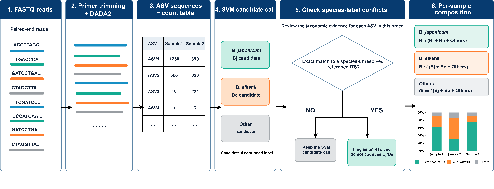

# BrayITS

BrayITS is a developing reference and classification framework for the bacterial 16S–23S rRNA ITS region amplified from soybean nodules. The assay follows [Teraishi et al.](https://doi.org/10.1002/pld3.70069). This repository shares a **candidate reference snapshot**, not a finished diagnostic classifier or GWAS phenotype.

The figure sketches the research idea; its abundance bars are illustrative.

## Candidate reference

We surveyed publicly available *Bradyrhizobium* genome assemblies, screened the reported assembly-quality metadata, reviewed source names against type-material genomes, and extracted the assay's primer-bounded ITS segment. Identical primer-trimmed sequences were grouped into haplotypes. The current snapshot contains **936 screened assembly accessions** and **307 unique candidate ITS sequences**. A genome name or a similar ITS sequence alone is not treated as proof of species identity.

The [reference directory](reference/candidate_v0_2/) contains:

- `assembly_inventory.tsv` — assembly accession and its original NCBI species name;
- `its_inserts.fasta` — distinct candidate ITS sequences, identified by `DNH` IDs;
- `haplotype_sources.tsv` — which assemblies contributed each candidate sequence;
- `haplotype_labels.tsv` — provisional species-evidence status for each sequence.

These records support inspection of the candidate reference. They do not certify all 307 sequences to species level. Detailed laboratory processing records and raw sequence data are outside this public release.

## Classification concept and current limit

An ASV classifier proposes *B. japonicum* (Bj), *B. elkanii* (Be), or another class. An exact match to a reference ITS whose species label is unresolved flags a conflict and prevents a confident Bj/Be count for that ASV. This is a **species-label check**, not a validated genus test. The classifier and the proposed Bj/Be/Others abundance denominator still need independent validation before use as a final phenotype.
